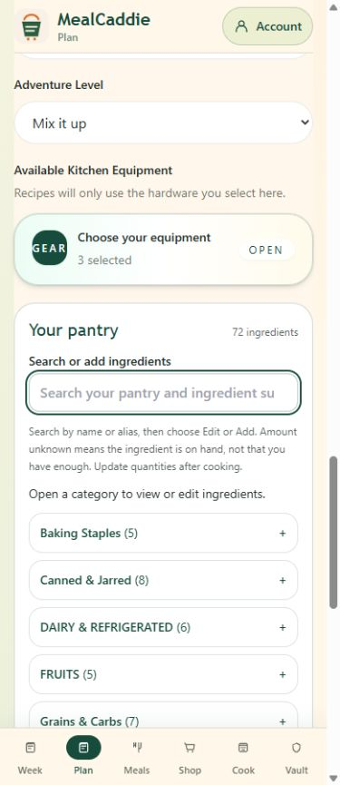
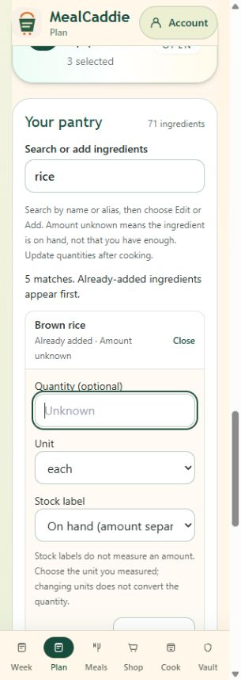
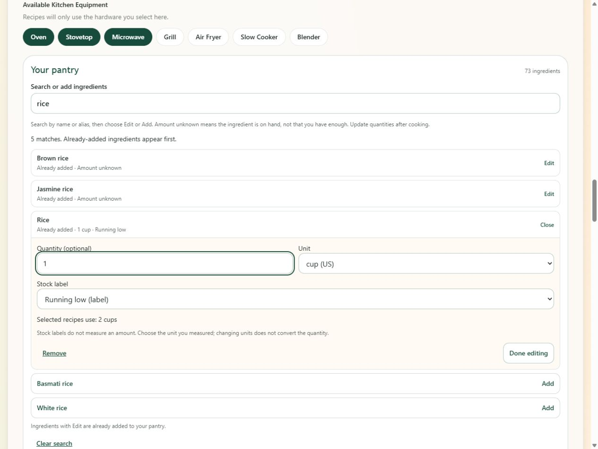

# Compact pantry review

Branch: `feature/compact-pantry`, based on production main `9f3f9b2573f3f7882ba50d736a9fbf96617d3497`. Review only; no production release authorized.

## Result

Plan now has one visible pantry picker in each responsive layout, replacing the duplicate Quick-Select and Snapshot surfaces. Search includes inventory, existing aliases and suggestions. Existing entries are marked **Already added** and open editing; suggestions/custom ingredients require an explicit Add action. Enter in search does not submit the planning form or add an ingredient.

Inventory starts as closed category disclosures. Opening a category mounts compact name/quantity/stock rows, twelve at a time, with a Show more action. Search uses a flat list with the same progressive limit. Only the selected row mounts its quantity/unit/stock/remove controls. There is no inner inventory scroll container and no hidden collection of 71 edit forms.

“On hand (amount separate)” replaces the ambiguous Owned label. Unknown quantities explicitly do not imply sufficient inventory. Existing quantity units, stock states, current-week sufficiency confirmations, storage, mutation callbacks, tier limits and grocery arithmetic are unchanged. Categories use existing canonical ingredient identities; unmatched custom entries appear in Other & custom. Different formulations and fresh/dried forms remain distinct.

## Verification — 2026-10-19 Central

| Check | Result |
|---|---|
| Automated regression | **308 passed**, zero failed/skipped. Includes new picker/grouping/summary/71-entry rendering tests and existing quantity, grocery, pantry ownership, storage authorization, scheduling, membership and safety coverage. |
| TypeScript / lint | Pass. Existing next-lint deprecation and Node typeless-module notices only. |
| Standard production build | Pass, original `.next`; no source changes during build. Owner ran the guarded helper in normal non-admin PowerShell because of the previously established restricted-context filesystem issue. Synthetic loopback configuration only. |
| Actual browser | Connected normal Chrome, real built application, disposable Free/Plus/third-owner auth/REST fixtures. No real account, shared database, email or external AI call. |
| 320 × 900 | Document width 305px with normal vertical scrollbar; no horizontal overflow. A 71-item inventory has one visible search, zero initial rows/editors; keyboard ArrowDown/Enter opens editing and focuses quantity. Tab commits a fraction/quantity; Done returns row focus. Escape closes editing. |
| 390 × 900 | Document width 375px. Custom Scallions is found by green onions without a duplicate Add action. Suggested Basmati rice adds immediately and can be removed; removal returns focus to search. |
| Desktop 1280 × 960 | Document width 1265px. One visible picker; quantity/unit controls share a row. Enter opens a category. After saving/reloading a 13-entry category, 12 rows mount initially and Show more mounts the thirteenth. Only one row editor mounts when switching between Rice and Brown rice. |
| Quantities / shortages | Carrots: 3 required − 2.5 each = 0.5. Rice across three recipes: 2 cups − 1 cup = 1 cup. Garlic powder: .75 tsp − .25 tsp = .5 tsp. Oil bottles are not converted to tablespoons; unknown milk stays required. Salt is skipped only after explicit current-selection sufficiency confirmation. |
| Persistence / isolation | Plus Save Week/reload retains 2.5 carrots/Running low and custom Scallions, and preserves removal of Basmati rice. Free edits support .5 cup but Save Week omits pantry; reload returns empty pantry. Third owner also has no Plus pantry. Switching back restores only Plus inventory. Fixture audit confirms Free pantry omitted and Plus pantry included. |
| Existing boundaries | Breakfast/lunch remain disabled with future-update wording; saved historical meals still render. No generation request, migration, authentication configuration, billing, entitlement, invitation, PR #9 or production data change. |

Full local evidence: `outputs/compact-pantry-browser-results.json`, `compact-pantry-build-result.json`, `compact-pantry-build.log`, `compact-pantry-regression.log`, and `compact-pantry-fixture-audit.json` outside Git. The inventory begins at 71 entries; screenshots after deliberate disposable additions show 72/73.

## Limits and release gate

Responsive emulation and keyboard/accessibility-tree checks passed; full NVDA, VoiceOver, TalkBack and physical-device validation are not claimed. Custom categories are not inferred from uncertain ingredient names. Pantry amounts remain user-maintained snapshots, not automatic consumption tracking (existing IMP-004). No new service, package dependency, migration or ongoing API cost is introduced.

Production merge/deployment requires separate owner approval. Existing allergy restrictions, billing and draft PR #9 remain unchanged. No unrelated improvement was implemented.
