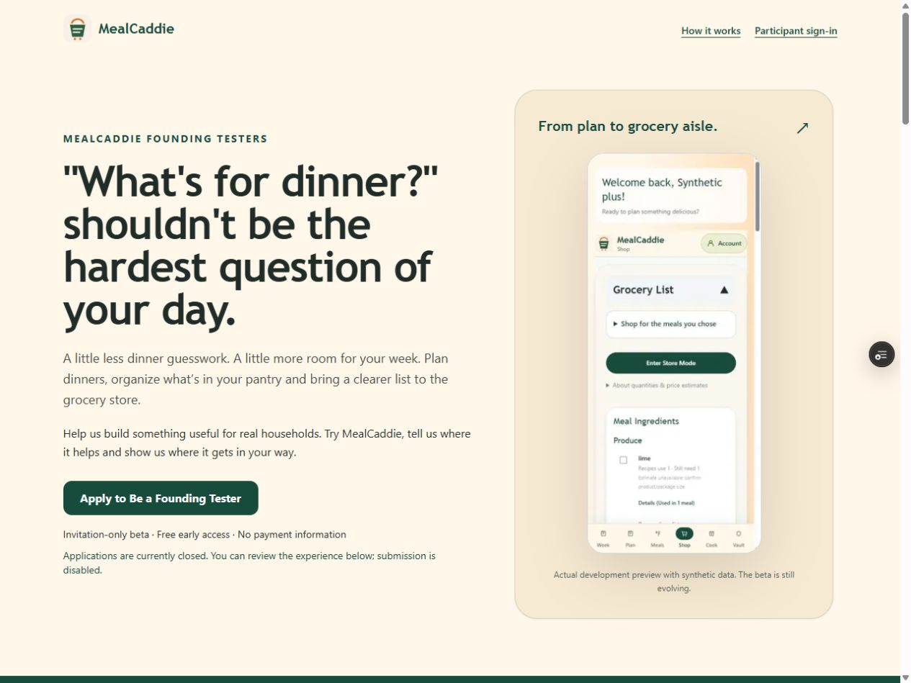
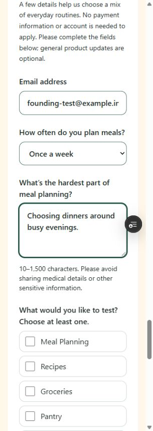

# Founding Testers recruitment review

## Scope and integration

Branch `feature/founding-testers`, based on production main `d0ecbb230b3b504e9612fea4425827062d61087d` (PR #11). Review Preview only; production release requires separate approval.

The existing public home presentation and `/beta` share one server-rendered landing component. `/beta#apply` embeds the existing client application form. The separate controlled pilot intake retains its standalone layout and verified email binding. No second backend, records, migration, dependency or environment change.

Authentication/onboarding is an integration boundary: `/auth/sign-in`, `/account/setup`, `/beta/accept`, `AuthHome` and its safe auth-return processing remain unchanged. The currently published `feature/beta-onboarding` ref is `806a59b`; its preserved local worktree is separate. No new authentication branch was published in the inspected remote references. This work does not merge that branch or overwrite local changes. Future login work should preserve these routes and recipient-bound return flow; resolve any shared public-home copy conflict around the shared landing component, not by replacing auth handlers. No unimplemented guest tour or new signup flow is advertised.

## Public copy

- Campaign: **MealCaddie Founding Testers**.
- Headline: **"What's for dinner?" shouldn't be the hardest question of your day.**
- CTA: **Apply to Be a Founding Tester** → existing `/beta#apply`.
- Value: dinner planning, pantry organization and a clearer grocery list; Plan → Shop → Cook.
- Selected testers get free early access, assigned Free or temporary Plus experience and an opportunity to shape improvements. No payment, subscription, ownership, compensation, lifetime access or guaranteed future perks.
- Applications are reviewed in small waves, with no guaranteed selection or immediate access. Internal 25-person target and initial 10–15 wave remain operational planning, not a changed database capacity.
- Existing participation boundary is repeated accurately: normally 30 days from acceptance, capped at December 31, 2026, 11:59 PM Central. No binding agreement text or program dates changed. Before a later launch, recheck remaining days; do not promise a full 30 days near the boundary.
- FAQ covers routines/eligibility, selection, access, dates, privacy and dietary limitations. Full safety, beta agreement and privacy links remain visible. Production allergy restrictions are unchanged.
- Required application consent and optional marketing consent remain distinct and unchecked. Submission success explains review, duplicates and invitation-only access, without exposing whether a particular email already exists.

## Existing pipeline and controls

`/api/beta/applications`, validation schema, consent version, Turnstile hostname/action verification, honeypot, HMAC rate limiter, transactional deduplication, applicant statuses, private administrator review, transactional admin notifications, invitation issuance and access gates are unchanged. A genuine submission may invoke the existing admin notification workflow; **no hosted application is submitted during this review**.

The embedded form defaults bounded campaign attribution to `founding-testers`; explicit valid UTM campaigns and existing source choices remain supported. Standalone pilot defaults are unchanged. Use `/beta?utm_source=friends&utm_campaign=founding-testers` for attributed recruitment links; no arbitrary referrer URLs are stored.

`betaPagesEnabled` / `betaSubmissionsEnabled` remain authoritative. No application, account creation, product access, AI or invitation flag is enabled by this PR. Closed review copy says submission is disabled. Vercel Authentication must remain enabled on Preview; do not generate bypass/share tokens or rebind `preview.mealcaddie.app`.

## Screenshot provenance

Assets in `public/founding-testers/` are exact copies of existing actual application screenshots, not fabricated product UI:

| Asset | Source | Context |
| --- | --- | --- |
| `pantry.png` | `docs/evidence/compact-pantry-desktop.png` | PR #11 local disposable 71-ingredient fixture, after test additions; rice search/edit controls. |
| `shop.jpg` | `docs/evidence/pantry-grocery-390-shop.jpg` | PR #10 loopback synthetic Plus fixture, grocery ingredient needs. |
| `cook.jpg` | `docs/evidence/pantry-grocery-320-cook.jpg` | PR #10 loopback synthetic Free fixture, example dinner schedule. |

The screenshots visibly identify synthetic test profiles where shown. No real customer records, account emails, invitation tokens or credentials. They are labeled development previews; catalog/search and other details may evolve. Together the three source images are under 140 KB before Next image optimization.

## Launch approvals

1. Approve the final landing/application copy, screenshot assets and selected release commit; authorize merge and production deployment separately. No migration is required.
2. Confirm the existing public legal/privacy documents, participation boundary and consent remain approved for recruitment. Any program-date/legal change needs its own approval.
3. Separately authorize any change to recruitment flags if closed. Required existing production flags are `BETA_PUBLIC_LAUNCH_APPROVED`, `BETA_APPLICATIONS_ENABLED`, `BETA_PRIVACY_REVIEW_APPROVED` and `BETA_CONTACT_MAILBOXES_VERIFIED`. Do not toggle them in this review. Preserve current controlled product and signup gates.
4. If a functional hosted Preview submission is requested, approve the exact Preview Turnstile hostname and bounded synthetic intake/admin-notification test first. This PR does not change allowlists or submit into the shared database.
5. Recruitment delivery/social publication, applicant approvals, invitation delivery, participation activation and any auth-rate change remain separate decisions. Applying alone grants none of them.

No new paid service or ongoing cost introduced. Full screen-reader/physical-device testing remains a separate launch gate; browser responsive and keyboard checks do not substitute for it.

## Verified review results (October 22, 2026)

| Check | Result |
| --- | --- |
| Focused automated coverage | **48 distinct tests pass** across focused runs: 8 real-component SSR/attribution/success/error tests, existing intake API and disposable PGlite database tests, and 19 existing product/access tests. Updated the old public CTA source assertion to follow the shared component; no authorization expectation was removed. Initial two assertion mismatches were corrected and affected tests rerun. No unrelated full suite. |
| TypeScript / lint | Pass. Next lint reports its existing future deprecation notice; no lint warnings/errors. |
| Production build, Preview only | Vercel READY, Preview deployment `dpl_2ExTzL4zo1wqDM99Vpyq5dUoCbub`, commit `4883808`, 35 seconds. Subsequent copy/evidence update gets its normal branch Preview build; see PR for final check. No local build retry or dependency operation. |
| Actual Chrome desktop | 1280×960, document width 1265px (vertical scrollbar); all three product screenshots load, one H1, clear CTA. `docs/evidence/founding-testers-desktop.jpg`. |
| Actual Chrome 320px | 320×900, document width 305px; no horizontal overflow. Keyboard CTA reaches `#apply`; native email type mismatch detected. Tab from challenges reaches first interest; Space toggles it. Required beta consent and optional unchecked marketing remain separate. Disabled submit cannot dispatch. `docs/evidence/founding-testers-320-form.jpg`. Only synthetic `.invalid` input was typed. |
| Actual Chrome 390px | 390×900, document width 375px; no horizontal overflow. CTA, editable form, routine selector and `utm_source=friends` display work. FAQ opens with Enter. CDP screenshot capture timed out; no successful 390px image is claimed. Desktop and 320px evidence are retained. Temporary viewport override reset. |
| Protected Preview | `/beta` works after existing Vercel session authentication. Anonymous HEAD returns HTTP 302 to Vercel SSO; no share/bypass link used. Preview applications are closed and submit remains disabled. |
| Public-home integration | Shared presentation is wired into existing `PublicBetaHome`, with existing `AuthHome` routing unchanged. Under this Preview’s unchanged product-gate settings, `/` still renders the existing guest planner. `/beta` is the review entry point. No flag was changed merely to demonstrate the home presentation. |
| Submission/access isolation | API and transactional duplicates, spam/Turnstile/rate failures, consent validation, private admin authorization, preserved accounts and denied unauthorized product use pass isolated tests. No hosted submission, inbox delivery, invitation redemption or new signup was performed. A functional shared Preview submission needs the separate bounded test/Turnstile/notification approval above. |
| Scope diff | API routes, database/migrations, food-safety response, product access, auth/account setup, dependencies, lockfile and deployment configuration unchanged. No production writes, emails, paid AI calls, beta activation or PR #9 changes. |

Protected review URL: `https://smartcart-git-feature-founding-testers-ljhooks6s-projects.vercel.app/beta`. Draft PR: https://github.com/ljhooks6/smartcart/pull/12.

