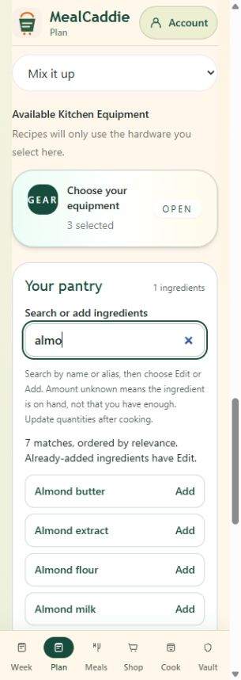
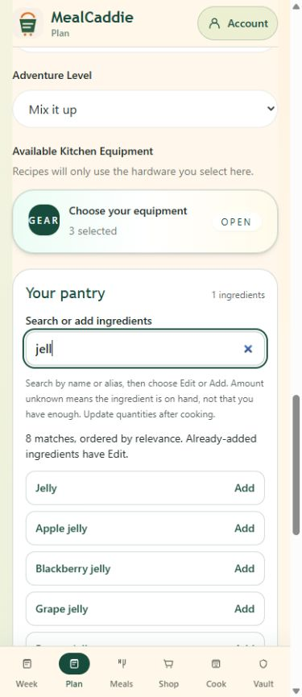
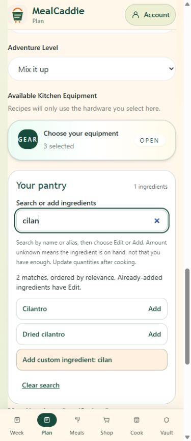
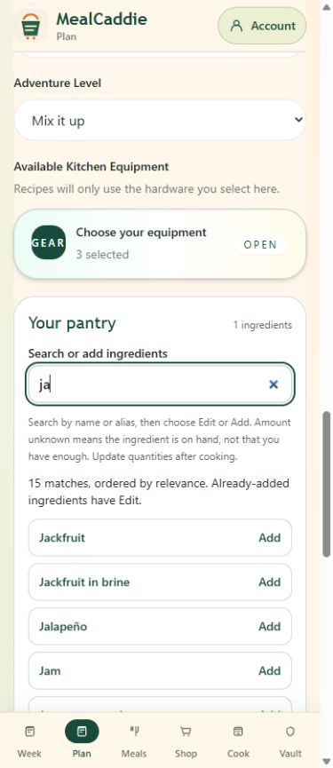
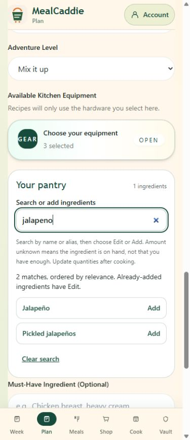
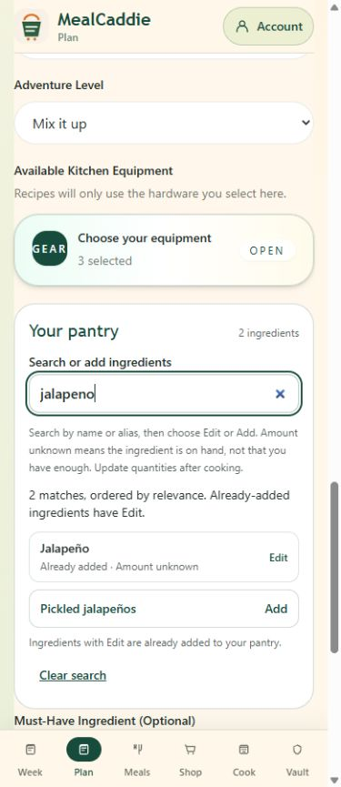
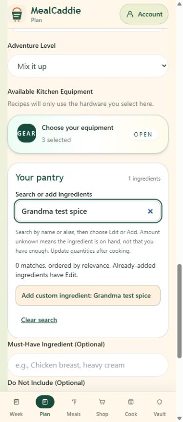

# Bundled ingredient discovery catalog

## Provenance and maintenance

`lib/ingredient-catalog.ts` contains **706 suggestions in 11 categories**. This is a MealCaddie-authored vocabulary, expanded from the original ingredient options in `smart-cart-app.fixed.tsx`; it is not a copied third-party database. The existing option names remain available. The app derives its option groups from this file, so there are not two competing suggestion lists.

Names cover ordinary U.S. groceries, produce, proteins, dairy and plant beverages, grains, legumes, nuts/seeds, herbs, spices, baking staples and common international ingredients. Each record has a display name, UI category and optional explicit discovery aliases. Add new records in their category, qualify forms/formulations when needed, and run the catalog/search tests. Do not add broad alias relationships that would conflate a fresh herb with its seed/spice or a plant beverage with its source nut. Ambiguous aliases cannot arbitrarily coalesce inventory entries.

These are **search labels**, not verified composition, nutrition, substitution, package-size or allergen data. No authoritative food-reference database or professional food-safety review is claimed. Discovery aliases never establish that products are interchangeable or safe for a declared allergy. Existing dietary and production allergy restrictions remain authoritative and unchanged.

## Search contract

`searchPantry` now delegates to the local deterministic ranking module. Identity still comes from the existing `ingredientKey`; this patch does not change it, quantity conversion, grocery subtraction, pantry persistence or safety validation.

Ordering is:

1. Exact name / existing canonical-key match.
2. Name prefix.
3. Word prefix (including consecutive multiword prefixes).
4. Explicit alias exact/prefix/word-prefix match.
5. Remaining name/alias substrings.

Already-added inventory wins only within the same relevance tier. Folded name order breaks other ties. An owned Salmon therefore cannot displace Almonds, Almond milk, Almond flour or Almond butter for `almo`.

Search folds Unicode accents, case, punctuation and spacing. Existing ingredient normalization still handles its established aliases; the vocabulary adds discovery terms such as AP flour, EVOO, TVP, aubergine, garbanzo beans, Jell-O and coriander leaves. Fresh Cilantro, Dried cilantro, Coriander seeds and Ground coriander stay separate records.

An existing inventory record matching a catalog spelling or explicit alias is offered as **Edit**, preserving its original stored name, quantity, unit, stock state and identity key. The matching catalog Add suggestion is suppressed. Separately stored legacy records are never merged or removed. This is picker presentation only; it does not rewrite the grocery identity system. Exact names/aliases suppress custom Add; incomplete or unmatched names still allow an explicit custom addition.

Typing, pressing Enter in search, ranking and alias lookup never add an ingredient or generate a meal. Add remains an explicit button action. The existing keyboard, focus, category and progressive-display behavior is retained. A live status now describes relevance ordering rather than claiming inventory always comes first.

## Cost and size

There is no fetch, paid ingredient API, AI request, new dependency or keystroke telemetry. Static catalog search fields are compiled once per module; owner-specific inventory is overlaid per call and is not retained in the shared catalog/cache. Category grouping is memoized while typing. The catalog source is **16,648 UTF-8 bytes / 5,519 gzip bytes**; these are vocabulary source measurements, not a claim about the complete Next.js bundle. Tests cap it at 64 KiB source / 12 KiB gzip and reject duplicate canonical keys.

## Verification

60 focused tests pass, including the reported queries, rank order, owned Salmon, accent/decomposed-Unicode matching, aliases, existing-entry Edit lookup, custom eligibility, distinct formulations, deterministic ordering and bounded catalog size. Existing pantry quantity, grocery, account isolation, membership, compact rendering and production allergy-restriction regressions also pass. TypeScript and lint pass. The prior complete PR #11 layout/persistence verification is retained in [compact pantry review](compact-pantry-review.md); this follow-up does not rerun unrelated database or recovery work.

PR #11 stays draft. No migration, production data/configuration change, billing, AI-generation rule or PR #9 change is included. Production merge/deployment needs separate owner approval.

## Actual protected Preview evidence — 2026-10-20

Vercel built application commit `b91772a5c05c842c4e9e49a35998c67a0bfcff81` successfully in 43 seconds: deployment `dpl_3YtZjPadgFZPHVeWX8wS1kLLFp1X`, **Ready / Preview**. The existing branch Preview URL remains https://smartcart-git-feature-compact-pantry-ljhooks6s-projects.vercel.app/planner. No environment variables or protection settings were changed.

The actual Preview was tested through connected normal Chrome at 320×900 and 390×900 using an initially empty guest pantry. Only temporary guest-local Salmon, Jalapeño and Grandma test spice were added explicitly, then removed. No account sign-in, shared record write, generation request or paid AI call occurred. The original empty pantry was restored and viewport override reset. Prior persistence/quantity/account tests are reused, not claimed as freshly exercised against real users.

| Acceptance case | Actual result |
|---|---|
| `almo` at 320px | Almond butter, Almond extract, Almond flour, Almond milk and Almonds precede the owned Salmon. Enter in search leaves the count at one. |
| `jell` at 390px | Jelly plus Apple, Blackberry, Grape, Pepper, Raspberry and Strawberry jelly; flavored gelatin dessert mix is a separately labeled alias result. |
| `cilan` | Cilantro first, Dried cilantro second; no conflation with Ground coriander. |
| `ja` | Jalapeño and Jasmine rice both appear in the first twelve results. Progressive display remains available. |
| `jalapeno` | Jalapeño first, Pickled jalapeños separately. No redundant custom button for this exact accent-insensitive match. |
| Existing inventory | After explicit guest addition, `jalapeno` shows Jalapeño / Already added / Edit, without a duplicate Jalapeño Add button. Enter opens one editor and focuses Quantity. |
| Custom ingredient | Unmatched Grandma test spice offers a custom Add button; explicit add and remove succeed. |
| Keyboard / layout | ArrowDown focuses the first result, Escape returns to search, typing/Enter never add, row Enter focuses quantity. Document widths 305/375px respectively including normal vertical scrollbar space; no horizontal overflow. |

Sanitized local receipt: `outputs/ingredient-search-browser-results.json`. Full NVDA/VoiceOver/TalkBack and physical-device coverage remain separate. Newly recorded IMP-005 proposes a separately reviewed grocery-identity alias improvement; no such grocery change is included here.
