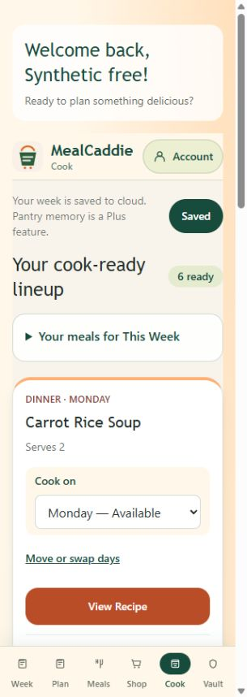
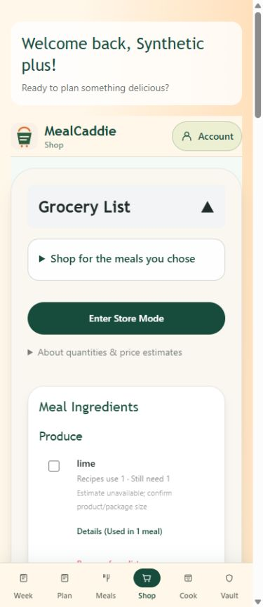
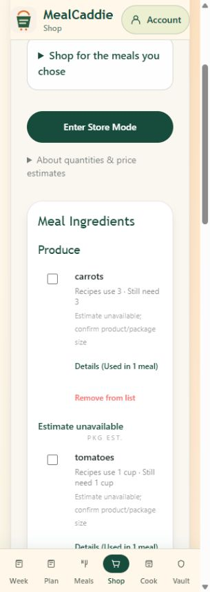
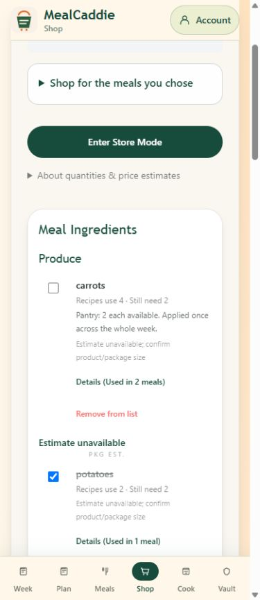

# Mobile verification — 2026-10-19

Status: **requested responsive browser checks, including generated-meal replacement, completed**. PR #10 remains draft and must not be marked ready for merge without owner approval. All testing used normal Windows Chrome through the existing extension, the actual local built application, loopback-only synthetic auth/REST/provider fixtures, and disposable data. No real accounts, hosted services, emails or paid AI calls were used.

## Results

| Check | Result / actual evidence |
|---|---|
| Exact viewport | Chrome viewport override verified via DOM: 320×900 and 390×900. Reset afterward. |
| Six tabs, Free and Plus | Week, Plan, Meals, Shop, Cook and Vault checked after their headings rendered at both widths. No horizontal overflow after the correction below. Meals has no generated options; populated saved content is covered in Week/Cook/Vault. |
| Pantry search and custom entries | Alias `green onion` finds existing `scallions`; duplicate addition prevented. Garlic cloves and garlic powder remain distinct. Custom entries, optional amount/unit and stock labels work; Quick-Select and Snapshot agree. |
| Unknown quantities | Amount unknown remains on the purchase list; explicit sufficiency confirmation excludes the ingredient for the current selection. Stock labels do not imply sufficient amounts. Confirmation is selection/session scoped, not permanent inventory. |
| Shared quantities | Carrots 2+1=3; rice dinners 1+½ cup plus dessert ½ cup=2 cups; garlic powder ½+¼ tsp=.75 tsp. Plus pantry subtraction occurs once: 2 carrots leaves 1; 1 cup rice leaves 1 cup; .25 tsp garlic powder leaves .5 tsp. |
| Conservative units and pricing | 1 bottle oil is not converted to tablespoons. Unknown salt stays unresolved. Salt/pepper split, preparation removed from lime/carrot identities. Prices remain unavailable instead of inventing package costs. Rice details list all three source recipes. |
| Persistence and isolation | Plus carrot edit to 2.5 each with low label survives Save Week/reload; legacy custom Family spice mix survives. Free pantry resets on reload, while its manual shopping extra/checkmark persist for that owner. Switching Free→Plus→other shows separate weeks, Vaults, pantry and extras. |
| Recalculation | Removing synthetic Carrot Roast updates rice gross 2→1.5 cups / shortage 1→.5 cup and garlic powder gross .75→.5 tsp / shortage .5→.25 tsp; carrots become covered by pantry. Navigation and schedule-only changes preserve valid shopping extras/checkmarks. |
| Scheduling | All seven days show availability or the assigned dinner. Quick selector disables occupied days. Explicit swap moves Soup to Tuesday and Roast to Monday; subsequent move to Saturday and removal of Potato's assignment work. Save/reload preserves metadata. Historical breakfast/lunch remain visible. |
| Keyboard | Enter opens scheduler; focus enters its Close button. Escape dismisses and restores focus to Move or swap days. Quantity Tab reaches its native unit select. |
| Tier behavior / pause | Free displays 5 plans/week and ten Vault recipes; Plus displays its existing policy and persistent pantry. Breakfast/lunch controls disabled with future-update text for guest/Free/Plus. Server/admin bypass rejection and ownership enforcement covered by automated tests, not inferred from mock REST. |
| Replacement browser flow | **Pass:** authenticated Free at 320px and Plus at 390px. Real route validation/membership checks run before loopback provider responses. Selected dinner replacement updates quantities, preserves Monday and other occupied days, clears changed rice marks, retains unchanged ingredient/manual-extra marks, and survives Save Week/reload. |

## Confirmed regression fixed

The populated Cook grid had a 367px document width at a 320px viewport. Native select intrinsic width expanded an implicit grid track. The correction gives Cook cards an explicit single-column grid/minimum width and stacks the native day-picker label/select on narrow screens with constrained select width. It does not change schedule rules, recipes, quota or authorization.

After rebuilding, all 24 Free/Plus tab/width combinations fit: document width ≤320 at 320px, and ≤390 at 390px. Cook measures 305/375 CSS px respectively with the normal vertical scrollbar. No clipping or hidden-overflow workaround is used.

## Verification and evidence

- Fresh standard `.next` production build: **pass**, exit 0; no source hashes, status, HEAD or branch changed during build. Owner ran the guarded helper in normal non-admin PowerShell because the earlier Codex filesystem EPERM remains unresolved.
- After the layout correction: **302 tests passed, 0 failed, 0 skipped**; standalone TypeScript and standard Next lint passed. Build also ran lint/type validation. Existing next-lint deprecation and local queue-region fallback notices remain.
- Browser console contained earlier fixture CORS errors, corrected before the successful account tests; no new application error was attributed to those historical entries. The request-origin rejection was resolved by matching the localhost fixture/browser origin; application origin validation was unchanged.
- Full local evidence outside the repository: `outputs/pantry-mobile-final-tab-matrix.json`, `pantry-mobile-plus-shop.txt`, `pantry-mobile-*.jpg/.png`, `pantry-grocery-mobile-fix-build.log`, `pantry-grocery-mobile-fix-after.json`, and `pantry-grocery-mobile-{regression,types,lint}.log`.
- Disposable REST fixtures exercise browser behavior; they do not prove hosted Supabase RLS or substitute for the existing database authorization suite.

## Final replacement acceptance and corrections

Installed Next.js 15.5.14 `NextURL` normalizes 127.0.0.1 to localhost; `NextRequest.url` uses that normalized value. Chrome was sending Origin http://127.0.0.1:3012 while the handler compared http://localhost:3012. A direct installed-framework check confirmed 127.0.0.1 and a foreign origin fail the unchanged guard, while localhost matches.

The supported local setup uses browser/application/fixture-CORS origin **http://localhost:3012**, with the server still bound only to 127.0.0.1. The same disposable service at 127.0.0.1:3013 supplies auth/REST and an OpenAI-compatible replacement response. The installed SDK's supported OPENAI_BASE_URL points only to that loopback provider route, with a dummy key. No URL-normalization flag, rewritten Origin, guard bypass, production key, shared migration, installation or hosted setting was needed. Normal-terminal restart was owner-assisted because of the established execution-context restriction.

Actual verification exposed and corrected three related defects:

- Replacement discarded the saved scheduledDay. It now preserves the latest current assignment and owner, while replacing recipe fields and rejecting a different owner/day. A stale response after an account switch cannot update the next account's generated plan.
- Replacement ingredient strings were assigned an invented 1 pack and guessed price. They now retain their actual measurement/preparation line for the shared conservative parser; unverified prices remain unavailable.
- Reload reconciled stored shopping marks against empty requirements before the saved week had loaded. Reconciliation now waits for the current owner's requirements. Real changes still clear stale marks.

| Final acceptance | Before replacement | After replacement and Save Week/reload |
|---|---|---|
| Free, 320×900 | Monday Soup: 2 carrots, 1 cup rice, .5 tsp garlic powder; separate Sunday Pasta | Monday Tomato Chickpea Skillet: 3 carrots, .5 cup rice, .25 tsp garlic powder; lime removed, chickpeas/tomatoes added. Pasta and manual napkin checkmarks survive; changed rice mark clears. 2 of 7 collected. |
| Plus, 390×900 | Selected dinners/dessert total 3 carrots, 2 cups rice, .75 tsp garlic powder; measured pantry 2 carrots, 1 cup rice, .25 tsp garlic powder | Gross 4 carrots/1.5 cups rice/.5 tsp garlic powder; shortages 2 carrots/.5 cup rice/.25 tsp garlic powder. Monday retained; Tuesday Roast and Wednesday Potato remain occupied. Potato/manual-extra marks survive reload; rice clears. 2 of 12 collected. |

Both widths fit without horizontal overflow (document 305/375px with normal vertical scrollbar). Repeat navigation/reload does not subtract inventory again. Unknown can sizes still show Confirm package size and prices remain unavailable. These are engineering fixtures, not meal-quality/allergen-safety evaluations.

Final evidence: `outputs/pantry-replacement-final-{320,390}.txt/.jpg`; `pantry-grocery-replacement-final-{build.log,after.json,tests.log,types.log,lint.log}`. Standard production build, **302/302 tests**, standalone TypeScript and lint passed on the final source. Build changed no source hashes/status/HEAD. Final fixture audit recorded one Free and one Plus mock replacement response, no external provider calls or emails, a Free save with pantry omitted and Plus save with its own snapshot. These in-memory fixture saves are not shared database writes.

The separate [read-only migration review](pantry-quantity-migration-review.md) leaves the migration checksum/SQL unchanged. No shared preflight or migration execution is claimed.
## Remaining gates

1. Owner review/approval remains required; keep PR #10 draft. Requested responsive browser verification is complete.
2. Separate shared pantry migration review/approval remains required; it has **not** been applied.
3. Physical-device and full screen-reader checks remain separate; desktop responsive emulation is not a claim of VoiceOver/TalkBack/NVDA completion.
4. PR stays draft, with branch deployment disabled. No merge or deployment is authorized. PR #9 and production remain untouched.
